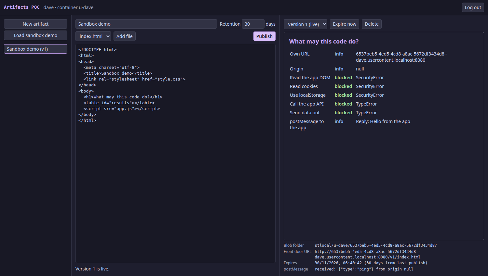

# artifacts-poc

My learning project: how would you build something like Claude Artifacts, where a user publishes a web page and the platform runs it safely?

I wanted to understand the systems design, so I rebuilt the idea locally with Docker and no cloud services. I built it together with Claude Code. This is a POC with a fake login, not something to deploy.



## Run it

```bash
git clone https://github.com/drzo1dberg/artifacts-poc.git
cd artifacts-poc
docker compose up -d --build
```

Then open <http://app.localhost:8080>. Chrome and Firefox resolve `*.localhost` on their own, Safari does not. To remove everything including data, run `docker compose down -v`.

## The one idea that explains the design

An artifact is untrusted code that runs next to your logged-in session. Without protection, it could call the API as you. Almost every decision here follows from that:

1. **App and content live on separate origins**, so the code never sees the session cookie.
2. **The browser enforces the limits** through sandboxing and a Content Security Policy.
3. **Versions never change.** A publish writes a new folder and then moves a pointer in the database, which makes every version safe to cache.
4. **Control plane and data plane are separate.** The API decides and keeps records. The front door serves content from blob storage.

## Architecture

```
                         Browser
        ┌───────────────────┴────────────────────┐
        │ app.localhost:8080                     │ <id>--<user>.usercontent.localhost:8080
        │ app and session cookie                 │ artifact in a sandboxed iframe
        └───────────────────┬────────────────────┘
                      ┌─────┴─────┐
                      │ frontdoor │  nginx: routing by host, edge cache, CSP
                      └─┬───┬───┬─┘
               /        │   │   │  usercontent: GET and HEAD only
         ┌──────────────┘   │   └─────────────────┐
      ┌──┴──┐  /api/   ┌────┴───┐    writes    ┌───┴───────┐
      │ web │          │  api   │ ───────────► │ blobstore │
      └─────┘          └────┬───┘              └───────────┘
                       ┌────┴─────┐
                       │ postgres │  users, artifacts, versions, retention
                       └──────────┘
```

| Service | Built with | Job | Code |
|---|---|---|---|
| `frontdoor` | nginx | The only way in | `frontdoor/default.conf` |
| `blobstore` | Go, standard library | Simulated storage account | `blobstore/main.go` |
| `api` | Go, pgx | Control plane and retention job | `api/main.go`, `api/blob.go`, `api/token.go` |
| `postgres` | PostgreSQL 17 | Metadata | `api/schema.sql` |
| `web` | TypeScript, no framework | Editor and preview | `web/src/main.ts` |

Each user gets one container, each artifact is a folder, and each version is a subfolder:

```
stlocal/                     storage account
└── u-alice/                 container, one per user
    └── <artifact-id>/       artifact
        ├── v1/              version, never changes
        │   ├── index.html
        │   └── js/app.js
        └── v2/
            └── index.html
```

## How it works

### Publishing

`publishVersion` in `api/main.go` does this:

```
1. BEGIN; SELECT live_version ... FOR UPDATE   parallel publishes wait here
2. base_version differs from live?             return 409, nothing changes
3. upload blobs to <id>/v(n+1)/                invisible, nothing points to them
4. record the version, set live_version = n+1
5. COMMIT                                      only now is it live
```

The commit is the switch. If the service dies before it, the worst case is a few orphaned blobs, and the next attempt clears them.

There are two kinds of locking here and I had to think about why. `FOR UPDATE` protects the few milliseconds of the check. `base_version` protects the minutes between loading an artifact and publishing it. If someone else published in between, you get a conflict instead of silently overwriting their work.

### Reading

```
GET <id>--alice.usercontent.localhost:8080/t/<token>/v2/index.html
  -> the hostname regex validates the ID and the user
  -> the API checks the token and that the artifact still exists
  -> edge cache: a HIT ends here
  -> blobstore: /u-alice/<id>/v2/index.html
```

You only get a link after logging in. The login is just a username, no password. The API signs a token for the owner, valid for 15 minutes and for one version of one artifact, and puts it into the path. It has to be the path, because relative URLs inherit it, so `style.css` and `app.js` carry the token automatically.

The link also refuses to open directly. Browsers send `Sec-Fetch-Dest: document` for a top-level visit and `iframe` inside our app, and scripts on the page cannot change that. So the content is only viewable on our canvas. curl can fake the header, so the token is what actually protects the content.

The front door asks the API before every read, using nginx `auth_request`, and this runs before the cache. That makes a delete effective immediately. The price is that reads now depend on the API and the database, so artifacts stop loading when the API is down. Only Postgres knows which version is live. The app asks the API and puts that link into the iframe.

Because `v2` never changes, publishing needs no cache invalidation. The next version simply has a new URL. The token stays out of the cache key, so new links still hit the cache.

### Isolation

Four independent layers:

| Layer | Where | What it stops |
|---|---|---|
| Separate domain | front door | The cookie is host-only and never reaches `usercontent` |
| `sandbox="allow-scripts"` | `web/index.html` | The origin becomes `null`: no DOM, cookies or storage |
| CSP header with `sandbox` | `frontdoor/default.conf` | Applies even when someone opens the URL without the iframe |
| `connect-src 'none'` | same header | `fetch` cannot call the API or send data out |

The only channel left is `postMessage`. The app checks the sending window, because the origin `null` tells it nothing. A feature like "ask Claude from an artifact" would use this bridge: the artifact asks, the app decides.

### Retention

The default is 30 days per artifact, and every publish restarts the clock. `purgeExpired` in `api/main.go` runs every 10 seconds, deletes the blobs and then writes a tombstone row.

- **Blobs first, database second.** After a crash in between, the job just runs again, because deleting is idempotent. The other order could leave data behind that nobody can find.
- **`FOR UPDATE SKIP LOCKED`** skips artifacts that a publish is working on.
- **Deleted means gone.** The API refuses the read even if the file is still in the edge cache, and the cached copy expires within 60 seconds.

## Try it

**Sandbox:** log in, click "Load sandbox demo", then "Publish". The artifact tries to break out and reports the results in a table.

**Conflict:** open the same artifact in two tabs and publish from both. The second tab gets a 409.

**Retention:** click "Expire now" and watch the job clean up within 10 seconds:

```bash
docker compose logs -f api                                  # retention: removed ...
docker compose exec blobstore find /data -type f            # the folder is gone
docker compose exec postgres psql -U artifacts -c \
  "select title, deleted_at, delete_reason from artifacts"  # the tombstone stays
```

**Login gate:** copy the front door URL shown in the app and open it in a new tab. You get a 403, because only the iframe in the app may show it. Remove the token from the URL and you get a 404.

**Edge cache:** run `curl -I -H "Sec-Fetch-Dest: iframe"` twice on that URL. You get `X-Cache-Status: MISS`, then `HIT`.

## How this would look on Azure

I have not deployed this. The mapping comes from reading the Microsoft Learn docs in October 2026. Treat it as a design sketch.

| POC | Azure |
|---|---|
| nginx | Front Door Standard with managed identity origin auth |
| blobstore | Storage account with Shared Key and anonymous access turned off |
| container per user | Blob container, the docs list no limit per account |
| Go API | Container Apps, with a managed identity for storage access |
| postgres | Azure Database for PostgreSQL Flexible Server |
| fake login | Entra ID, assuming all users are internal, and a signed session cookie |
| retention job | Container Apps job, plus a lifecycle policy as a safety net |

The interesting part is what does not map one to one:

**Hostname to path.** Front Door rule sets have no capture groups I could use, so nginx's regex has no direct equivalent. They do offer substrings of the `hostname` variable. This only works here because a UUID has a fixed length, so for `*.usercontent.example.com` a URL rewrite with preserve unmatched path could look like this. I have not tested it:

```
/u-{hostname:38:-24}/{hostname:0:36}/
```

**Wildcard domain.** `*.usercontent.example.com` needs a wildcard certificate, which I would keep in Key Vault.

**Caching needs explicit headers.** Without a `Cache-Control` header, Front Door picks a random cache time of one to three days. It also refuses to cache `no-cache`, which the POC sends to browsers. So the edge cache time needs an explicit rule or a header like `s-maxage=60, max-age=0`.

**Purging is weak, and the design does not need it for publishing.** Purge can take up to 10 minutes and is not directly supported for wildcard domains, so you have to name each subdomain. Microsoft itself recommends versioned URLs for updates, which is what this design does. A real delete is different: a guaranteed quick removal stays an open problem, and a short cache time is the simple answer.

**"Retention policy" means two things.** A lifecycle management policy deletes data after a while. An immutability policy forbids deleting it for a while. This project wants the first one.

**A lifecycle policy alone is not enough.**

- It knows nothing about the database, so the tombstone and the "restart on publish" logic stay in the job.
- It works on blob age, so it could remove an old version of an artifact that is still in use.
- It allows 100 rules per policy, so one rule per user does not scale. One rule per retention class does.
- Changes can take up to 24 hours and runs have no fixed schedule, so a per-artifact deadline needs the job anyway.

**Folders are a real decision.** Without hierarchical namespace there are no folders, so deleting an artifact means listing its blobs and deleting them in a batch. With hierarchical namespace you get real folders, but lifecycle rules can no longer filter on blob index tags, because that filter is for flat namespace accounts only.

**Entra users do not fit into the hostname as they are.** With internal users, the container name could come from the Entra object ID, but that is a 36 character UUID. Two UUIDs plus `--` make 74 characters, and a DNS label allows 63. The API would have to keep a short slug per user in Postgres.

### No SAS tokens

SAS tokens are not always bad. Key-signed SAS tokens are the ones to avoid, because they depend on the account key. Microsoft recommends a user delegation SAS when someone without an identity needs temporary access. This design has no such caller, because every caller can have a managed identity:

| Caller | Identity | Role |
|---|---|---|
| API | User-assigned managed identity | Storage Blob Data Contributor |
| Front Door | User-assigned managed identity | Storage Blob Data Reader |

Turning off Shared Key on the account means key-signed SAS tokens stop working. Front Door cannot write, because its role does not allow it. The API creates the per-user containers at login with its identity.

The tradeoff is that managed identity origin auth does not work with Private Link. The storage account stays reachable over the internet and relies on Entra ID alone. That is why this would use Standard and not Premium.

**Private artifacts need more than Front Door.** The POC gates reads with a signed link that the front door checks through the API. Entra login alone does not do that on Azure, because Front Door reads with its own identity and not the user's. A SAS token would not help either, because it does not carry over to the relative `style.css` and `app.js`.

## Where this differs from real Claude Artifacts

Documented by the artifact server Claude uses: a sandboxed frame, a CSP that blocks `fetch` and allows a few CDNs, private by default, a UUID as slug, `index.html` as the entry point, relative paths across several files, and versions with a conflict check on `base_version`.

Everything behind that is my own model. How Anthropic stores, routes and retains artifacts is not public. Containers per user, the hostname scheme and retention are what I wanted to learn, not a copy of their internals. This project is not affiliated with Anthropic.

## What I learned

- Security here comes down to one question: how do you show code without giving it your session? Answering it shaped the whole architecture.
- Immutable versions make hard problems disappear: publishing needs no cache invalidation.
- The order of two steps decides what a crash leaves behind, both when publishing and when deleting.
- Mapping to the cloud teaches more than the happy path. Most of what I learned about Azure came from the things that do not translate one to one.

## Known shortcuts

- The login is only a username and the cookie is not signed, so anyone can be anyone.
- A copied link stays valid for up to 15 minutes, even after logging out, for anyone who fakes the fetch header.
- A page left open longer than 15 minutes cannot load further files until the artifact is reopened.
- There is no HTTPS.
- Every publish sends all files, and only text files work, because they travel as JSON strings.
- A publish holds a database lock during the upload. It is correct but does not scale. A real version would upload under a random ID first and then move the pointer with `UPDATE ... WHERE live_version = base`.
- The database password in `docker-compose.yml` is a local development value. Postgres has no published port.
